Animated dashboard

<picture>
  <source media="(max-width: 600px) and (prefers-reduced-motion: reduce)" srcset="./assets/dashboard-mobile-still.svg">
  <source media="(prefers-reduced-motion: reduce)" srcset="./assets/dashboard-still.svg">
  <source media="(max-width: 600px)" srcset="./assets/dashboard-mobile.svg">
  
</picture>

[View without animation](./assets/dashboard-still.svg)

## Projects

### 01 · [Online retail analytics](https://github.com/artlee12/biodata_project)

An ETL pipeline processes sales data, builds customer and daily sales summaries, and visualizes key metrics in Streamlit.

`Dask` · `Prefect` · `PostgreSQL` · `Streamlit` · `Docker Compose`

[Setup guide (Russian)](https://github.com/artlee12/biodata_project/blob/main/GUIDE.md)

### 02 · News topic classification

Compared TF-IDF with logistic regression, a CNN, DistilBERT, and a stacking ensemble to classify news articles by topic. A Jupyter notebook contains data preparation, training, and evaluation.

`scikit-learn` · `PyTorch` · `Transformers` · `Optuna`
